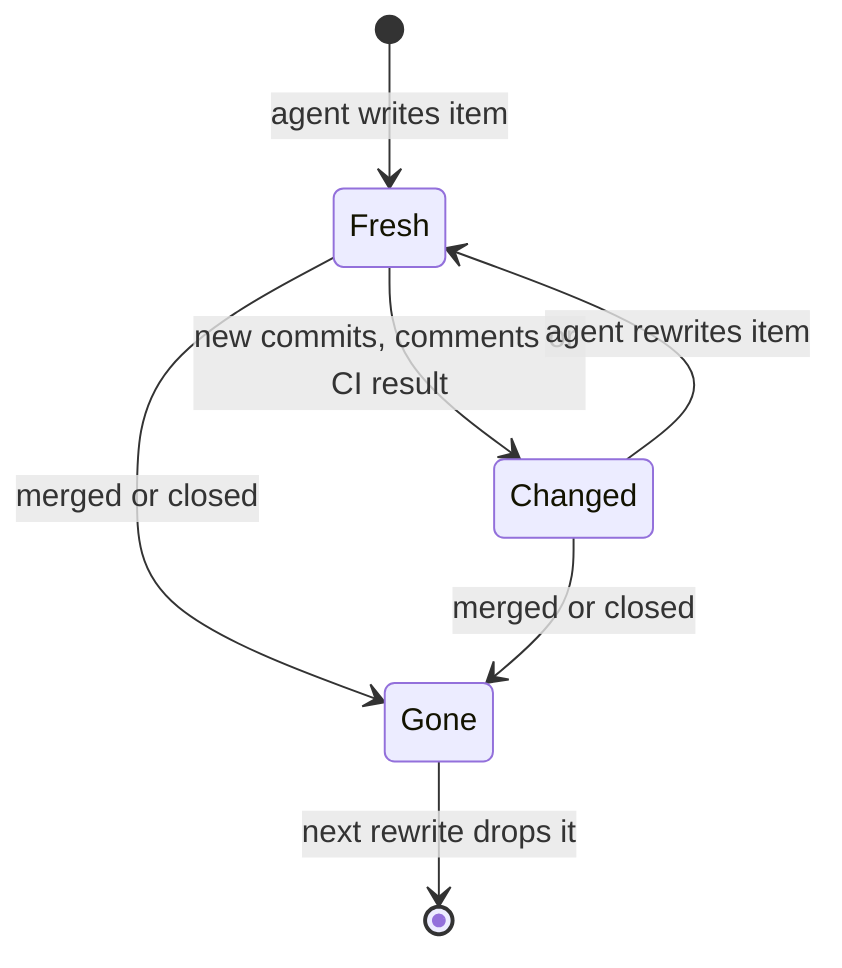
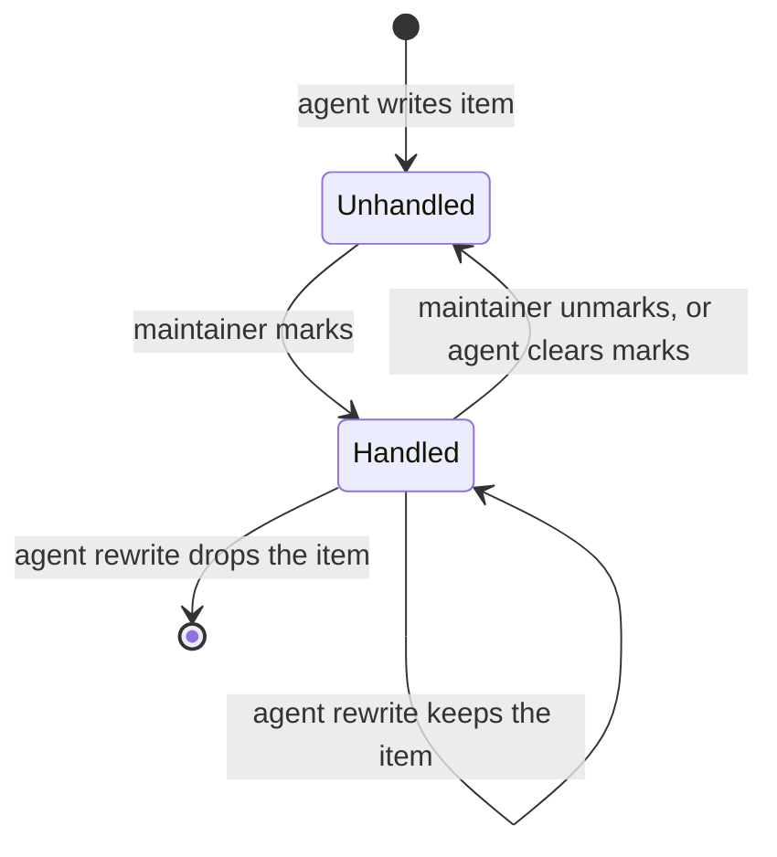
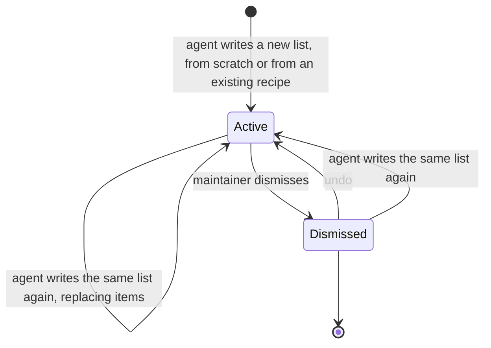
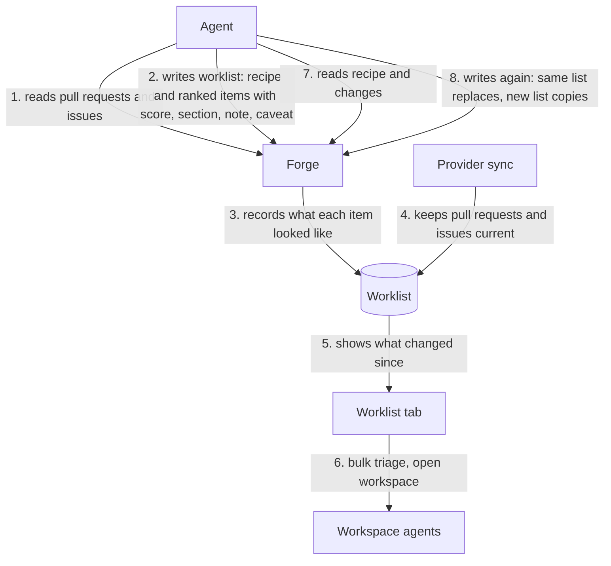

# Worklists

A worklist is an ordered list of pull requests and issues, possibly across
repositories and providers, that an agent builds for a maintainer to work
through.

## Ownership

- Agents author worklists through the Forge MCP server, or hand the
  maintainer a worklist link that the UI imports only after they confirm. The
  UI reads, dismisses, marks items handled, and acts on worklists but never
  writes or reorders items itself.
- The agent owns judgment. Each item carries a rank, a 1 to 10 importance
  score, a section, a note, and a caveat. Readiness is a section, not part of
  the score.
- Each worklist carries a recipe: the criteria in plain text and the searches
  the agent ran. Forge stores and shows the recipe but never evaluates it.
- Forge owns facts. When an agent writes an item, Forge records what the item
  looked like then: head commit, comment count, CI result, review decision, and
  open, merged, or closed state. Comparing that record with the live synced
  item produces the changes since the list was written, without provider calls.
- Items identify repositories by provider-verified stable identity, never by
  owner/name alone (`context/platform-sync-invariants.md`).
- Worklists cover pull requests and issues from every supported provider.
  Kata tasks are out of scope for now.

## Freshness

- An item is Fresh, Changed (new commits, comments, CI result, review decision,
  or a reopen since it was written), or Gone (merged or closed since it was
  written, or no longer a visible synced row: its repository is inactive or no
  longer configured, or the item was deleted or removed upstream). Freshness
  is derived on read from the recorded snapshot and the live row, never stored
  (`internal/db/worklists.go::CompareWorklistItem`).
- Freshness and the embedded list row use the same tracked repositories as
  the pull request and issue lists, so list summaries, MCP reads, and HTTP
  reads agree. The row is null only when the item is no longer a visible
  synced row; a merged or closed Gone item keeps its live row
  (`internal/server/worklistapi/handler.go::Handler.trackedRepoIDs`).
- Changes since the list was written are informational. Show them as quiet
  markers that name what changed and when the agent wrote the item, not as
  warnings, and keep the list usable.
- New commits mean a review verdict quoted in a note may cover an older head;
  say so next to the note.
- Gone items stay on the list, shown as gone, until an agent rewrites the
  list. Only an agent write returns a Changed item to Fresh.

## Handled marks

- The maintainer marks an item handled once they dealt with it, even while it
  is still open. Handled is the maintainer's record; Gone is upstream state.
  The two are independent, and a row shows both
  (`internal/db/worklists.go::DB.SetWorklistItemsHandled`).
- Agents cannot mark items. An agent clears every mark on a list with
  `kenn_forge_clear_worklist_marks`, and only when the maintainer asks
  (`internal/mcpserver/tools_worklists.go::Server.registerWorklistTools`).
- A mark survives an agent rewrite for every item that stays on the list,
  matched by repository row, item type, and number. A new item, or one removed
  and added back by a later rewrite, starts unhandled. A copy starts unhandled
  (`internal/db/worklists.go::DB.PutWorklist`).
- Marking is idempotent and keeps the first time; unmarking an unhandled item
  does nothing. A mark is not an agent write: it leaves `updated_at` alone.

## Refresh and copies

- Reading a worklist over MCP returns its recipe and each item's changes since
  it was written. Freshness tracks only state, commits, comments, CI, and
  review decision, so it shows where to look first; a refresh reruns the
  recipe's searches, reconciles the full candidate set, and rewrites the list
  (`internal/mcpserver/guidance.md`).
- Writing to an existing worklist replaces its items and resets what Forge
  recorded for each one. Writing a new worklist from an existing recipe makes a
  copy; that is how "another one like that" works.

## Storage and transport

- Worklists live in `forge_worklists` and `forge_worklist_items`. Items key
  on the repository row: deleting that row deletes its items, so they leave
  the list. Deactivating a repository or removing it from config keeps the
  row, and its items show as Gone
  (`internal/db/migrations/000070_worklists.up.sql`).
- A put validates the whole list before writing: title 1 to 200 characters
  after trimming, recipe up to 10,000, 1 to 200 unique items, score null or 1
  to 10, section up to 80, note and caveat up to 4,000
  (`internal/mcpserver/tools_worklists.go::ValidateWorklistPut`).
- A put is one transaction. Every item must resolve to a tracked repository
  and a visible synced pull request or issue; one miss rejects the list with a
  typed not-found error naming `item_index`, and nothing is written
  (`internal/server/mcp_backend_worklists.go::mcpBackend.putWorklistLocal`,
  `internal/db/worklists.go::DB.PutWorklist`).
- Replacing a list rewrites its items and their snapshots, bumps `updated_at`,
  clears a dismissal, and records the writer's `created_by` and workspace
  (`internal/db/worklists.go::DB.PutWorklist`).
- Dismiss and restore are idempotent; a repeated dismissal keeps the first
  timestamp. Lists omit dismissed worklists unless asked for them
  (`internal/db/worklists.go::DB.SetWorklistDismissed`).
- Worklists are hub-owned. Spokes forward every MCP and HTTP read and write to
  the hub and never fall back to local rows when the hub is unavailable
  (`internal/server/mcp_backend_worklists.go::mcpBackend.PutWorklist`,
  `internal/server/spokeapi/provider_sources.go::HubProviderSource.PutWorklist`).
  An execution worker with no hub to forward to answers every worklist MCP
  tool with `serviceUnavailable`
  (`internal/server/mcp_backend_worklists.go::mcpBackend.localWorklists`).
- Spoke preparation handoff does not move worklists. They are short-lived and
  an agent can rebuild one from its recipe.
- HTTP reads, dismisses, restores, and marks; agents write through MCP. Each
  item embeds the same row the pull request or issue list returns, or null once
  the item is no longer a visible synced row. A dismissed list stays readable
  by ID with `dismissed_at` set.
- A mark request names items by provider-verified repository identity, item
  type, and number, and marks or unmarks them in one transaction. An unknown
  repository or an item that is not on the list rejects the request with
  `details.item_index`, and nothing changes. The response carries the summary
  and each requested item's `handled_at`, so the UI needs no second read
  (`internal/server/worklistapi/handler.go::Handler.SetHandledService`).
- Responses to federation callers carry no workspace references: embedded
  rows have no workspace and `workspace_id` is empty, because the reader
  cannot tell which machine a workspace ID names. For the same reason the hub
  records no workspace for a put a spoke forwards, so that list has no
  `workspace_id` even on the hub
  (`internal/server/provider_route_wrappers.go::Server.federationPutWorklist`).
  A spoke serves a worklist
  read itself, from the hub's copy, and adds its own workspaces to the
  embedded rows, as for the pull request and issue lists
  (`internal/server/worklistapi/handler.go::Handler.GetService`,
  `internal/server/worklistapi/handler.go::Handler.GetProviderService`).
- The hub broadcasts `worklists_changed` with `{"worklist_id": N}` after every
  put, dismissal, restore, mark, or clear (`internal/server/worklistapi/handler.go::Handler.PublishChanged`).

## Links

- Other tools build links with the public `worklist` package, the shape the MCP
  put tool takes; never copy the shape (`worklist/link.go::Fragment`).
- The fragment is `v1.` plus raw-DEFLATE, unpadded base64url JSON, not zstd:
  browsers and scripts build links too. It never reaches a request line.
- `kenn://kenn-forge/worklists/import#…` routes through the Kenn desktop app,
  whose link allowlist lives outside this repository.
- Opening a link never writes; any page can link there, so only the
  maintainer's confirm creates the list (`internal/server/worklistapi/import.go`).
- Untracked, unsynced, or repeated items are skipped, never added; every
  import creates a new list.

## UI

- Worklists appear as a header tab only while at least one exists, or while
  the worklists page is open so the tab survives dismissing the last list
  (`frontend/src/lib/components/layout/AppHeader.svelte`).
- An import that finishes after the maintainer left the page does not
  navigate (`frontend/src/lib/views/WorklistImportView.svelte`).
- `/worklists` opens the newest list; the selected item lives in the query
  string as on Activity, so a reload keeps it (`frontend/src/lib/routes.ts`).
  The query carries the repository's stable identity, and rows, selection, and
  replacement after a rewrite all match items by it. Owner/name in the URL is
  only the display route; the detail loads from the matched item's current
  route (`frontend/src/lib/components/worklists/worklist-items.ts::worklistItemKey`).
- The list is a rail of compact rows beside the regular pull request or issue
  detail view. The rail is the pull request list's collapsible sidebar, with
  the same app-wide toggle and shortcut, width, and narrow overlay. `j`, `k`,
  and `d` keep working while it is collapsed, following the saved row order
  (`frontend/src/lib/views/WorklistView.svelte`). The rail header switches
  between two orders: Agent order, the default, groups rows by section in the
  agent's rank; Score is one flat list, highest score first, ties by rank,
  unscored items last. The choice is browser-local and survives a reload.
  Keyboard steps, `d`, and the changed filter follow the visible order in both
  (`frontend/src/lib/components/worklists/worklist-items.ts::worklistItemsByScore`).
- Each row shows the score, the title, `owner/name#number` with the note and
  caveat, the changes since, and live status from the embedded row. Rows show
  the same labels and status icons as the pull request and issue lists, from
  the same shared component, so the two cannot drift; past a width cap the
  icons wrap, and rows never overflow the rail at its minimum width
  (`frontend/src/lib/components/shared/PullStatusIcons.svelte`,
  `frontend/src/lib/components/worklists/WorklistRow.svelte`).
  Workspace and pull request actions work there as on other surfaces.
- With more than one list, the title is a picker that shows each list's
  remaining count: items neither handled nor gone. Handled and gone overlap,
  so the server computes it rather than the UI subtracting the other counts
  (`internal/db/worklists.go::SummarizeWorklist`).
- A handled row stays in place, dimmed, with a check in its status area. The
  rail header shows how many items are handled. The context strip toggles the
  open item's mark, and the selection bar marks or unmarks every selected item
  and clears the selection at once. `d` marks the open item and, once the mark
  succeeds, moves to the next row as `j` does, skipping collapsed sections, but
  only while the same list and item are still open; a failed mark leaves the
  item open, and on an already handled item `d` only moves
  (`frontend/src/lib/views/WorklistView.svelte::markCurrentAndAdvance`).
- Bulk actions run a quick action, such as triage, on the selected items with
  bounded concurrency, each in its own workspace. Selections mix pull requests
  and issues, so item menus name the actual mix and apply each action only to
  eligible items (`frontend/src/lib/components/sidebar/ItemActionsMenu.svelte`).
- Dismissing a worklist can be undone; a dismissed list returns only through
  undo or an agent rewrite of the same list. Dismiss and Undo are one state
  machine: idle, dismissing, undo window, restoring. A completion acts only
  while the machine is still in the state that started it. The list stays on
  screen while it is dismissing, since its change event can beat the
  response. A dismissal that finishes after the maintainer switched lists or
  left the page updates the store but neither navigates nor offers undo; a
  restore likewise navigates only if the page still shows what it showed when
  Undo was pressed. Undo stays until the restore succeeds; a failed restore
  reopens the undo window and shows the error. A successful restore clears the
  cached list's dismissal. Leaving the page cancels the undo window, never the
  request
  (`frontend/src/lib/components/worklists/worklist-dismissal.svelte.ts`).
- An open list dismissed elsewhere is treated as missing: the view moves to
  the newest open list or the empty state, except while this view's undo for
  that list is showing (`frontend/src/lib/views/WorklistView.svelte`).
- When an agent rewrite drops the open item, the selection moves, replacing
  the URL, to the row that now takes its place in the visible order, else the
  row before it; with no rows left the detail closes
  (`frontend/src/lib/views/WorklistView.svelte::replacementFor`).
- A list whose items were all removed keeps its title, recipe, and Dismiss in
  the rail and says no items remain. Long notes, caveats, and recipes scroll
  inside bounded boxes so the detail pane and rows keep their room
  (`frontend/src/lib/components/worklists/WorklistRail.svelte`).
- The open list re-reads on `worklists_changed`, `data_changed`, reconnects,
  and, while lists show agent status, `workspace_status`. The agent-status
  list poll never reads worklists. Every worklist read, including startup,
  open, and retry, reports a hub outage to the provider-unavailable banner
  (`frontend/src/lib/app-stores.svelte.ts`).
- The empty state appears only after the list read succeeds with no lists; a
  failed read shows the error, and a hub outage raises the provider-unavailable
  banner.

## Information flow

