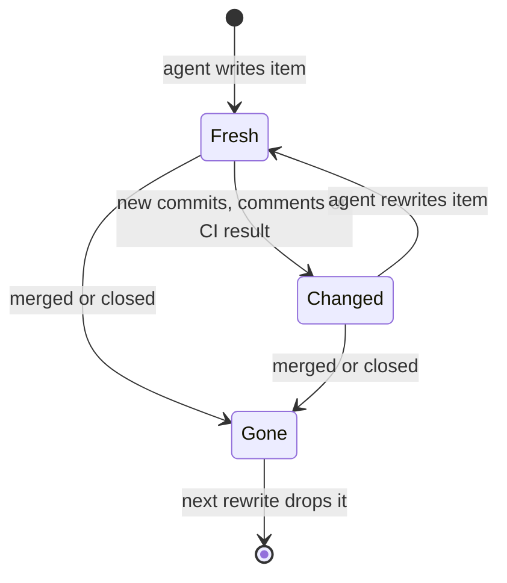
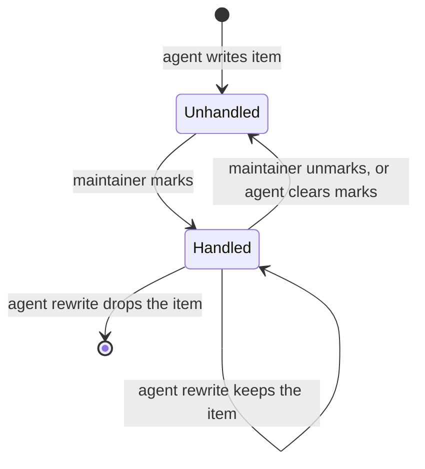
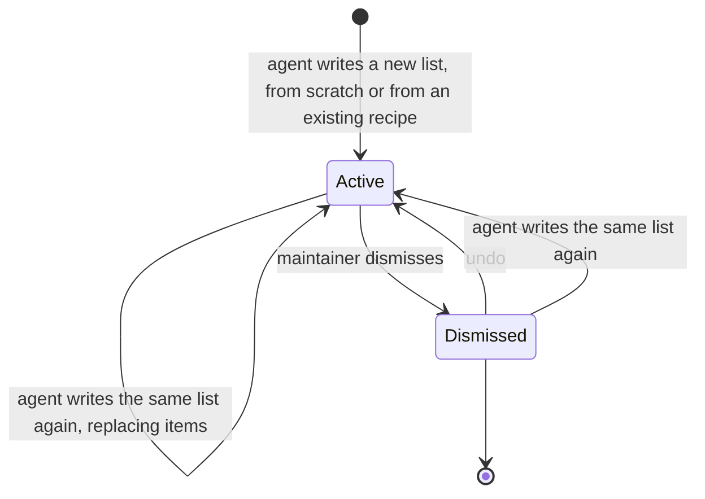

# Worklists

A worklist is an ordered list of pull requests and issues, possibly across
repositories and providers, that an agent builds for a maintainer to work
through.

## Ownership

- Agents author worklists through the Forge MCP server or a worklist link.
  The UI reads, dismisses, marks handled, and acts on worklists, and opening a
  link stores its list, but the UI never edits or reorders items.
- The agent owns judgment: rank, a 1 to 10 score, section, note, and a caveat
  with a level. Readiness is a section, not part of the score.
- A caveat level is info, warning, or critical; an unset level is info, so only
  a concern the agent raises on purpose looks alarming.
- Each worklist carries a recipe: plain-text criteria and the searches the
  agent ran. Forge stores and shows the recipe but never evaluates it.
- Forge owns facts: it records each item's state when written and derives
  changes since by comparing with the live synced row, without provider calls.
- Stored items use provider-verified stable repository identity, never
  owner/name alone (`context/platform-sync-invariants.md`); a link naming only
  owner/name is resolved to stable identity before writing.
- Worklists cover pull requests and issues from every supported provider.
  Kata tasks are out of scope for now.

## Freshness

- An item is Fresh, Changed (new commits, comments, CI result, review decision,
  or a reopen), or Gone (merged, closed, or no longer a visible synced row).
  Freshness is derived on read, never stored.
- An item's embedded live row is null only when it is no longer a visible
  synced row; a merged or closed Gone item keeps its row.
- Freshness and embedded rows use the same tracked repositories as the pull
  request and issue lists, so list summaries, MCP reads, and HTTP reads agree.
- Changes since writing are informational: quiet markers naming what changed
  and when the agent wrote the item, not warnings; the list stays usable.
- New commits mean a review verdict quoted in a note may cover an older head;
  say so next to the note.
- Gone items stay on the list until an agent rewrites it. Only an agent write
  returns a Changed item to Fresh.

## Handled marks

- The maintainer marks an item handled once they dealt with it, even while it
  is open. Handled is the maintainer's record and Gone is upstream state; they
  are independent and a row shows both.
- Agents cannot mark items. An agent clears every mark on a list only when the
  maintainer asks (`internal/mcpserver/tools_worklists.go::Server.registerWorklistTools`).
- A mark survives an agent rewrite for every item that stays on the list. A new
  item, one removed and added back, or an item in a copy starts unhandled.
- Marking is idempotent and keeps the first mark time. A mark is not an agent
  write and does not change the list's updated time.

## Refresh and copies

- Freshness tracks only state, commits, comments, CI, and review decision, so
  it shows where to look first; a refresh reruns the recipe's searches,
  reconciles the full candidate set, and rewrites the list (`internal/mcpserver/guidance.md`).
- Writing to an existing worklist replaces its items and resets what Forge
  recorded for them. Writing a new worklist from an existing recipe makes a
  copy; that is how "another one like that" works.

## Storage and transport

- Deleting a repository row removes its items from lists; deactivating or
  unconfiguring a repository keeps them, shown as Gone.
- A put is all-or-nothing: every item must resolve to a tracked repository and
  a visible synced pull request or issue, or the whole list is rejected naming
  the failing item index.
- Worklists are hub-owned. Spokes forward every MCP and HTTP read and write to
  the hub and never fall back to local rows; a worker with no hub answers every
  worklist tool as unavailable.
- Spoke preparation handoff does not move worklists; they are short-lived and
  an agent can rebuild one from its recipe.
- Only MCP replaces a list. HTTP reads, dismisses, restores, marks, builds
  links, and imports links; a dismissed list stays readable by ID.
- A mark request is all-or-nothing and names items by stable repository
  identity, item type, and number.
- Federation responses carry no workspace references, and the hub records no
  workspace for a spoke-forwarded put, because a workspace ID does not say which
  machine it names. A spoke adds its own workspaces when serving a read.

## Links

- The public `worklist` package owns the link format (`worklist/link.go::Fragment`);
  other producers use its JSON field names, and the Python-built fragment in its
  tests is the cross-language test vector.
- The fragment is `v1.` plus raw-DEFLATE, unpadded base64url JSON, not zstd,
  because browsers and scripts build links too. It never reaches a request line.
- `kenn://kenn-forge/worklists/import#…` works only through an application that
  handles `kenn://` links and admits the path; `/worklists/import#…` works on
  any Forge origin.
- Opening a link creates its list with no confirm step, since an unwanted list
  is dismissed like any other. The same list always maps to the same worklist,
  keyed by a hash of the list's JSON rather than the fragment text, and
  reopening it restores it if dismissed.
- The link follows its worklist, not its contents (maintainer decision): after
  an agent rewrites the list, or its items go away, the link still opens it.
- A copied link carries title, recipe, author, and items with current routes;
  never handled marks, snapshots, or stable IDs. It names a caveat level only
  above info.
- The server builds copied links because browsers cannot reproduce Go's
  DEFLATE. An inactive repository refuses the link, since another repository
  may hold its route (`internal/server/worklistapi/link.go::Handler.LinkService`).
- The UI copies only the `kenn://` form, and only when an embedding app sets
  `window.__KENN_EMBEDDED_KENN_LINKS__` before page scripts run: a
  browser-level signal, never Forge config (maintainer decision).
- Untracked, unsynced, or repeated items are skipped, never added, and the UI
  reports how many. A link with no usable item and no earlier worklist creates
  nothing, and the page shows why.
- MCP import and the import page share one service, so validation, dedupe,
  skips, and counts match.

## UI

- Worklists always appear as a header tab, including before any list exists.
- An import that finishes after the maintainer left the page does not navigate.
- `/worklists` reopens the last list shown in this browser, else the newest;
  arriving on a list reopens its last open item while still shown, else its
  first row. Both memories are browser-local.
- The selected item lives in the query string, keyed by stable repository
  identity; owner/name in the URL is only the display route.
- The rail is the pull request list's collapsible sidebar, beside the regular
  detail view; `j`, `k`, and `d` keep working while it is collapsed.
- The rail offers Agent order (default: by section in the agent's rank) and
  Score order (highest first, ties by rank, unscored last). The choice is
  browser-local; keyboard steps, `d`, and the changed filter follow it.
- The rail shows open items by default; merged, closed, and no longer synced
  items show under Closed or All. Closed means live state, not a change since
  writing. The choice is browser-local.
- Search uses the pull request list's query syntax, applies within the state
  filter, and resets when the rail remounts. The changed filter, once on, stays
  on with its button visible even when nothing matches.
- When the open item leaves the rail, for example because it merged, the
  detail stays open, and `j`, `k`, and a later replacement step from where its
  row was.
- Rows share the pull request and issue lists' label and status-icon component
  so they cannot drift, and never overflow the rail at its minimum width.
- An info caveat is muted; warning is amber and critical red, and only those
  two announce their level to screen readers.
- The list picker shows each list's remaining count (neither handled nor
  closed). The server computes it because handled and closed overlap.
- A handled row stays in place, dimmed. Rail progress counts done items:
  handled, merged, or closed.
- `d` marks the open item and advances only after the mark succeeds and only
  while the same list and item are still open; on a handled item it only moves
  (`frontend/src/lib/views/WorklistView.svelte::markCurrentAndAdvance`).
- Bulk actions run a quick action on each selected item in its own workspace
  with bounded concurrency, applying each action only to eligible items in a
  mixed pull request and issue selection.
- A dismissed list returns only through Undo or an agent rewrite. A dismiss or
  restore completion acts only while the page still shows what started it; a
  late one updates the store but neither navigates nor offers undo.
- The list stays on screen while dismissing, since its change event can beat
  the dismiss response.
- Undo stays until the restore succeeds; a failed restore reopens the undo
  window with the error. Leaving the page cancels the undo window, never the
  request (`frontend/src/lib/components/worklists/worklist-dismissal.svelte.ts`).
- An open list dismissed elsewhere is treated as missing, except while this
  view's undo for that list is showing.
- When an agent rewrite drops the open item, selection moves (replacing the
  URL) to the row now in its place, else the row before; with no rows left the
  detail closes.
- The context strip's collapsed state applies to every item and is
  browser-local.
- A list with no items left keeps its title, recipe, and Dismiss. Long notes,
  caveats, and recipes scroll inside bounded boxes.
- The agent-status poll never reads worklists. Every worklist read reports a
  hub outage to the provider-unavailable banner.
- The empty state appears only after a successful read with no lists; a failed
  read shows the error.
