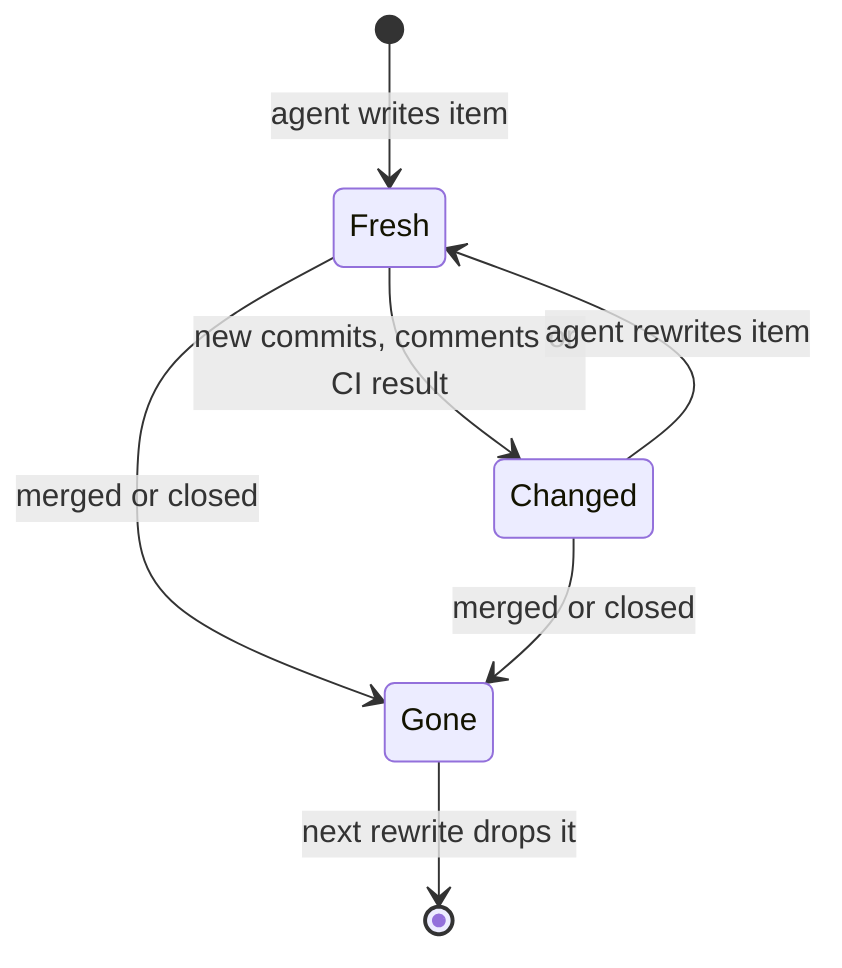
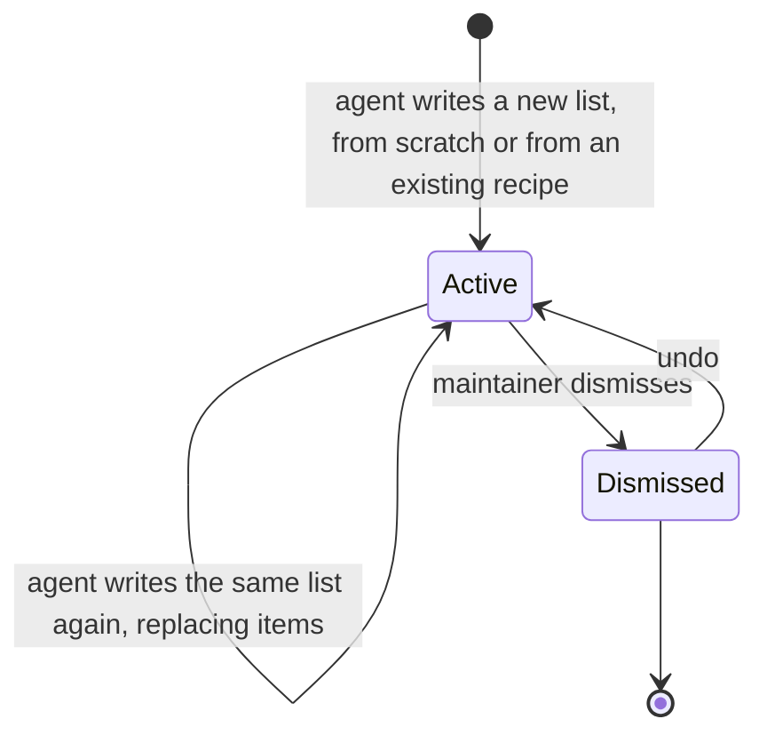
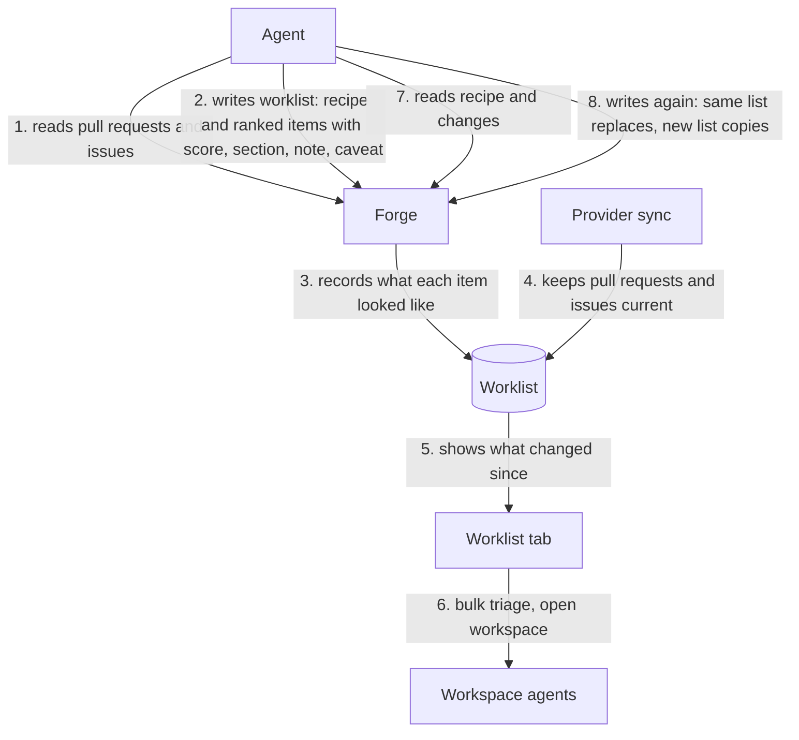

# Worklists

A worklist is an ordered list of pull requests and issues, possibly across
repositories and providers, that an agent builds for a maintainer to work
through.

## Ownership

- Agents author worklists only through the Forge MCP server. The UI reads,
  dismisses, and acts on worklists but never authors or reorders items.
- The agent owns judgment. Each item carries a rank, a 1 to 10 importance
  score, a section, a note, and a caveat. Readiness is a section, not part of
  the score.
- Each worklist carries a recipe: the criteria in plain text and the searches
  the agent ran. Forge stores and shows the recipe but never evaluates it.
- Forge owns facts. When an agent writes an item, Forge records what the item
  looked like then: head commit, comment count, CI result, review decision, and
  open, merged, or closed state. Comparing that record with the live synced
  item produces the changes since the list was written, without provider calls.
- Items identify repositories by provider-verified stable identity, never by
  owner/name alone (`context/platform-sync-invariants.md`).
- Worklists cover pull requests and issues from every supported provider.
  Kata tasks are out of scope for now.

## Freshness

- An item is Fresh, Changed (new commits, comments, CI result, review decision,
  or a reopen since it was written), or Gone (merged or closed since it was
  written, or no longer a visible synced row: its repository is inactive or no
  longer configured, or the item was deleted or removed upstream). Freshness
  is derived on read from the recorded snapshot and the live row, never stored
  (`internal/db/worklists.go::CompareWorklistItem`).
- Freshness and the embedded list row use the same tracked repositories as
  the pull request and issue lists, so list summaries, MCP reads, and HTTP
  reads agree. Only a Gone item has a null row
  (`internal/server/worklistapi/handler.go::Handler.trackedRepoIDs`).
- Changes since the list was written are informational. Show them as quiet
  markers that name what changed and when the agent wrote the item, not as
  warnings, and keep the list usable.
- New commits mean a review verdict quoted in a note may cover an older head;
  say so next to the note.
- Gone items stay on the list, marked, until an agent rewrites the list. Only
  an agent write returns a Changed item to Fresh.

## Refresh and copies

- Reading a worklist over MCP returns its recipe and each item's changes since
  it was written, so an agent can re-evaluate only what changed.
- Writing to an existing worklist replaces its items and resets what Forge
  recorded for each one. Writing a new worklist from an existing recipe makes a
  copy; that is how "another one like that" works.

## Storage and transport

- Worklists live in `forge_worklists` and `forge_worklist_items`. Items key
  on the repository row: deleting that row deletes its items, so they leave
  the list. Deactivating a repository or removing it from config keeps the
  row, and its items show as Gone
  (`internal/db/migrations/000070_worklists.up.sql`).
- A put validates the whole list before writing: title 1 to 200 characters
  after trimming, recipe up to 10,000, 1 to 200 unique items, score null or 1
  to 10, section up to 80, note and caveat up to 4,000
  (`internal/mcpserver/tools_worklists.go::ValidateWorklistPut`).
- A put is one transaction. Every item must resolve to a tracked repository
  and a visible synced pull request or issue; one miss rejects the list with a
  typed not-found error naming `item_index`, and nothing is written
  (`internal/server/mcp_backend_worklists.go::mcpBackend.putWorklistLocal`,
  `internal/db/worklists.go::DB.PutWorklist`).
- Replacing a list rewrites its items and their snapshots, bumps `updated_at`,
  clears a dismissal, and records the writer's `created_by` and workspace
  (`internal/db/worklists.go::DB.PutWorklist`).
- Dismiss and restore are idempotent; a repeated dismissal keeps the first
  timestamp. Lists omit dismissed worklists unless asked for them
  (`internal/db/worklists.go::DB.SetWorklistDismissed`).
- Worklists are hub-owned. Spokes forward every MCP and HTTP read and write to
  the hub and never fall back to local rows when the hub is unavailable
  (`internal/server/mcp_backend_worklists.go::mcpBackend.PutWorklist`,
  `internal/server/spokeapi/provider_sources.go::HubProviderSource.PutWorklist`).
- Spoke preparation handoff does not move worklists. They are short-lived and
  an agent can rebuild one from its recipe.
- HTTP is read, dismiss, and restore only; agents write through MCP. Each item
  embeds the same row the pull request or issue list returns, or null once the
  item is gone. A dismissed list stays readable by ID with `dismissed_at` set.
- Responses to federation callers carry no workspace references: embedded
  rows have no workspace and `workspace_id` is empty, because the reader
  cannot tell which machine a workspace ID names. A spoke serves a worklist
  read itself, from the hub's copy, and adds its own workspaces to the
  embedded rows, as for the pull request and issue lists
  (`internal/server/worklistapi/handler.go::Handler.GetService`,
  `internal/server/worklistapi/handler.go::Handler.GetProviderService`).
- The hub broadcasts `worklists_changed` with `{"worklist_id": N}` after every
  put, dismissal, or restore (`internal/server/worklistapi/handler.go::Handler.PublishChanged`).

## UI

- Worklists appear as a header tab only while at least one exists, or while
  the worklists page is open so the tab survives dismissing the last list
  (`frontend/src/lib/components/layout/AppHeader.svelte`).
- `/worklists` opens the newest list; the selected item lives in the query
  string as on Activity, so a reload keeps it (`frontend/src/lib/routes.ts`).
- The list is a rail of compact rows beside the regular pull request or issue
  detail view, grouped by section in the agent's rank order. It is a list,
  not a table, so it has no sortable columns. Each row shows the score, the
  title, `owner/name#number` with the note and caveat, the changes since, and
  live status from the embedded row; rows never overflow the rail at its
  minimum width (`frontend/src/lib/components/worklists/WorklistRow.svelte`).
  Workspace and pull request actions work there as on other surfaces.
- Bulk actions run a quick action, such as triage, on the selected items with
  bounded concurrency, each in its own workspace. Selections mix pull requests
  and issues, so item menus name the actual mix and apply each action only to
  eligible items (`frontend/src/lib/components/sidebar/ItemActionsMenu.svelte`).
- Dismissing a worklist can be undone; a dismissed list never returns on its
  own. An open list dismissed elsewhere is treated as missing: the view moves
  to the newest open list or the empty state, except while this view's undo for
  that list is showing (`frontend/src/lib/views/WorklistView.svelte`).
- The empty state appears only after the list read succeeds with no lists; a
  failed read shows the error, and a hub outage raises the provider-unavailable
  banner.

## Information flow

