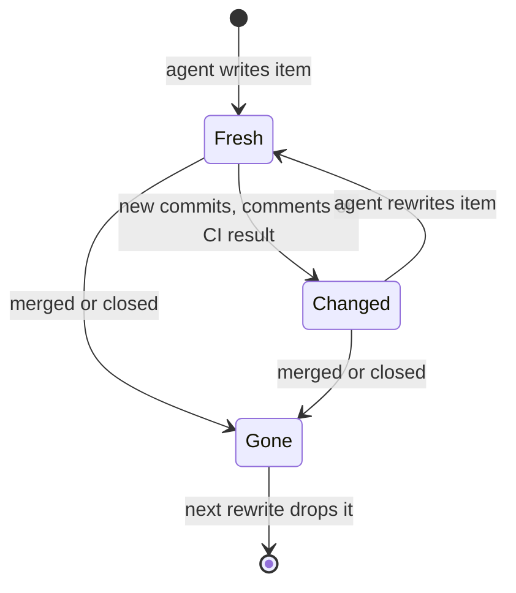
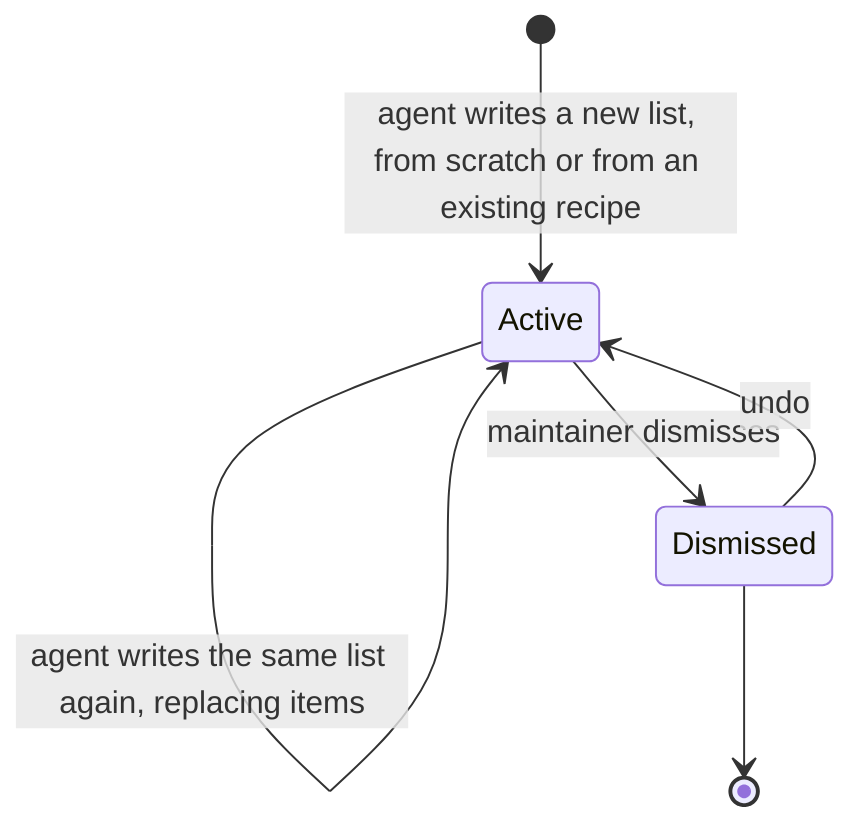
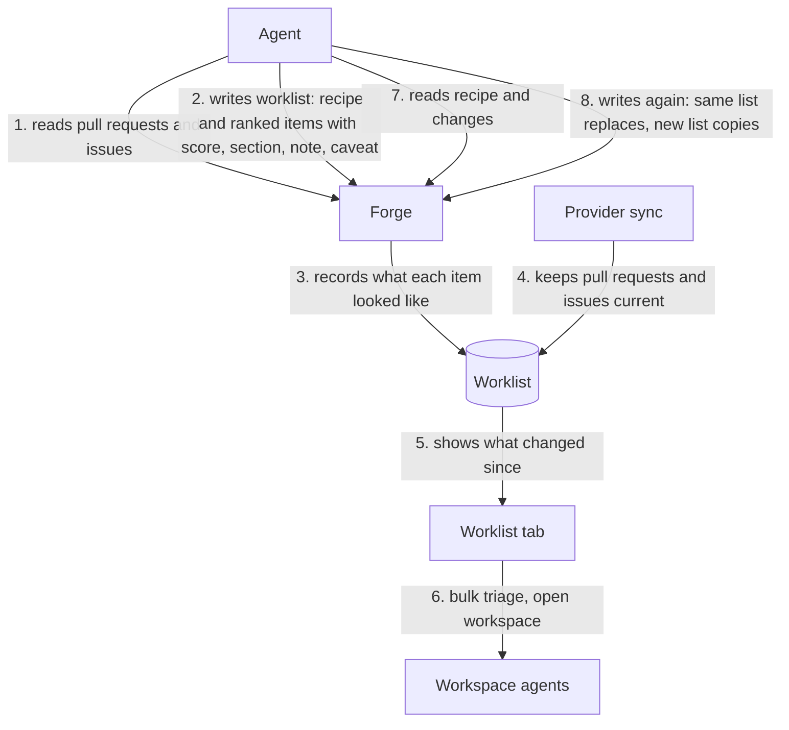

# Worklists

A worklist is an ordered list of pull requests and issues, possibly across
repositories and providers, that an agent builds for a maintainer to work
through. These rules describe the planned feature.

## Ownership

- Agents author worklists only through the Forge MCP server. The UI reads,
  dismisses, and acts on worklists but never authors or reorders items.
- The agent owns judgment. Each item carries a rank, a 1 to 10 importance
  score, a section, a note, and a caveat. Readiness is a section, not part of
  the score.
- Each worklist carries a recipe: the criteria in plain text and the searches
  the agent ran. Forge stores and shows the recipe but never evaluates it.
- Forge owns facts. When an agent writes an item, Forge records what the item
  looked like then: head commit, comment count, CI result, review decision, and
  open, merged, or closed state. Comparing that record with the live synced
  item produces the changes since the list was written, without provider calls.
- Items identify repositories by provider-verified stable identity, never by
  owner/name alone (`context/platform-sync-invariants.md`).
- Worklists cover pull requests and issues from every supported provider.
  Kata tasks are out of scope for now.

## Freshness

- An item is Fresh, Changed (new commits, comments, or CI result since it was
  written), or Gone (merged or closed since it was written).
- Changes since the list was written are informational. Show them as quiet
  markers that name what changed and when the agent wrote the item, not as
  warnings, and keep the list usable.
- New commits mean a review verdict quoted in a note may cover an older head;
  say so next to the note.
- Gone items stay on the list, marked, until an agent rewrites the list. Only
  an agent write returns a Changed item to Fresh.

## Refresh and copies

- Reading a worklist over MCP returns its recipe and each item's changes since
  it was written, so an agent can re-evaluate only what changed.
- Writing to an existing worklist replaces its items and resets what Forge
  recorded for each one. Writing a new worklist from an existing recipe makes a
  copy; that is how "another one like that" works.

## UI

- Worklists appear as a header tab only while at least one exists.
- The list is a table beside the regular pull request or issue detail view;
  workspace and pull request actions work there as on other surfaces.
- Bulk actions run a quick action, such as triage, on the selected items with
  bounded concurrency, each in its own workspace.
- Dismissing a worklist can be undone; a dismissed list never returns on its
  own.

## Information flow

